# Studio user guide

Studio is a Windows app for making animations for inZOI's Zois. You can:

* pose a Zoi like a doll and set keys on a timeline;
* describe a motion in words and let the AI animate it;
* act a motion out on a webcam or a video;
* import Mixamo, mocap and VRM animations.

You can then watch the result live on your Zoi in the running game, or export it as a pack for the inZOI ModKit.

This guide explains every part of Studio. The step-by-step path from a finished animation to a working in-game mod is covered in its own guide: **[Getting your animations into inZOI](ANIMATIONS_IN_INZOI.md)**.

> Studio is an unofficial fan project. It is not affiliated with KRAFTON or inZOI Studio.

## Contents

1. [Install Studio](#1-install-studio)
2. [First start](#2-first-start)
3. [The Studio window](#3-the-studio-window)
4. [How an animation is organised](#4-how-an-animation-is-organised)
5. [Tutorial: your first animation](#5-tutorial-your-first-animation)
6. [Posing in the viewport](#6-posing-in-the-viewport)
7. [The inspector (right panel)](#7-the-inspector-right-panel)
8. [The timeline](#8-the-timeline)
9. [The transport bar](#9-the-transport-bar)
10. [The library (left panel)](#10-the-library-left-panel)
11. [Describe a motion (AI)](#11-describe-a-motion-ai)
12. [Act it out (webcam or video)](#12-act-it-out-webcam-or-video)
13. [Import animations and characters](#13-import-animations-and-characters)
14. [Characters: how your Zoi looks](#14-characters-how-your-zoi-looks)
15. [Stages: animations in several parts](#15-stages-animations-in-several-parts)
16. [Scenes with several Zois](#16-scenes-with-several-zois)
17. [Reference props and display options](#17-reference-props-and-display-options)
18. [Save, open, autosave and undo](#18-save-open-autosave-and-undo)
19. [Export](#19-export)
20. [Live in inZOI](#20-live-in-inzoi)
21. [Keyboard and mouse reference](#21-keyboard-and-mouse-reference)
22. [What Studio remembers](#22-what-studio-remembers)
23. [Limits](#23-limits)
24. [Troubleshooting](#24-troubleshooting)
25. [Known quirks](#25-known-quirks)

---

## 1. Install Studio

### What you need

| | |
|---|---|
| Windows | Windows 10 or 11, 64-bit |
| WebView2 | The Microsoft Edge WebView2 Runtime. It is built into Windows 11 and most up-to-date Windows 10 PCs. Setup warns you if it is missing, and Studio shows Microsoft's download link when it cannot find it. |
| Graphics card | Any card works for posing and animating. The AI for **Describe a motion** runs much faster on an NVIDIA card with driver 525 or newer. Without one it runs on the processor. |
| Disk space | Studio itself is small. The AI setup asks for 8 GB free with an NVIDIA card (6.5 GB stays in use) and 3 GB free without one. |
| Internet | Needed once, to download the AI, and the first time you use **Act it out**. Everything else works offline. |
| inZOI | Optional. When it is installed, Studio finds it on its own: the inZOI body, the in-game mod and the live link use it. |

### Running Setup

1. Download **`Studio-Setup-1.1.1.exe`** (or newer) from the project's Releases page.
2. Double-click it. Setup installs for your Windows account only, so there is no administrator prompt.
   * If Windows shows **"Windows protected your PC"**, click **More info**, then **Run anyway**. This appears because the installer is not code-signed yet.
3. **Welcome page:** click **Next**.
4. **Select Destination Location:** keep the default (`%LOCALAPPDATA%\Programs\Zoi Motion Studio`) unless you have a reason to change it. Click **Next**.
5. **Select Additional Tasks:**

   | Option | Default | What it does |
   |---|---|---|
   | **Create a desktop shortcut** | off | Adds a Studio icon to the desktop. The Start menu entry is always created. |
   | **Install the Zoi Animation Studio mod into inZOI** | off | Only shown when inZOI is found. Copies the in-game Animations panel mod into `Documents\inZOI\Mods\InGame\ZoiAnimFramework`. It is experimental and has not been tested inside the game yet; see [Getting your animations into inZOI](ANIMATIONS_IN_INZOI.md#6-the-in-game-animations-panel). |
   | **Download the AI for Describe a motion** | on | Downloads and sets up the AI once, at the end of the install. About 4 GB to download (6.5 GB on disk) with an NVIDIA card, about 1 GB without one. |

6. **Ready to Install:** click **Install**.
7. **Installing:** the files are copied in a few seconds. If you kept the AI box ticked, Setup then shows *"Setting up the AI for Describe a motion. The download can take a while..."*. The progress bar and the line under it show each step:
   * a private copy of Python;
   * PyTorch: the NVIDIA build when your card supports it, otherwise the processor build;
   * the MSFlow model and the DistilBERT text encoder, each checked against its published checksum;
   * a self-test.

   On a fast connection this takes about 3 minutes.
   * If the AI download fails, Setup says so in a message box and still finishes. Studio works without the AI, and you can download it later from inside Studio (see [section 11](#11-describe-a-motion-ai)).
8. **Finish:** leave **Open Studio** ticked and click **Finish**.

### Where Studio keeps things

| What | Where |
|---|---|
| The app (and the AI, the in-game mod source, the Blender add-on and these docs) | `%LOCALAPPDATA%\Programs\Zoi Motion Studio` |
| Your saved projects | `Documents\Zoi Motion Studio\Projects` |
| Your exports | `Documents\Zoi Motion Studio\Exports\<pack id>` |
| Autosave, preferences and saved poses | Inside the app window's private profile in `%LOCALAPPDATA%\Zoi Motion Studio` |
| The in-game mod (only if you install it) | `Documents\inZOI\Mods\InGame\ZoiAnimFramework` |

### Updating and uninstalling

* **Update:** run the newer `Studio-Setup-x.y.z.exe`. It installs over the old version, and your projects, poses and settings stay.
* **Uninstall:** open Windows **Settings → Apps → Installed apps**, find **Studio** and choose **Uninstall**. This removes the app and the AI.
  * It keeps `Documents\Zoi Motion Studio` (your projects and exports) and `%LOCALAPPDATA%\Zoi Motion Studio` (your autosave, poses and settings).
  * If Setup installed the in-game mod, its files are removed too, but the folder holding your installed packs is left alone.

### Running Studio without installing

If you have the project folder instead of the installer, double-click **`Start Studio.bat`**.
* A small console window opens. Keep it open: it is Studio's helper.
* Studio then opens in your web browser at `http://localhost:47820/`.
* Everything works the same way, except that the AI is only available after you run its setup (`ai\setup_ai.ps1`).

---

## 2. First start

Open **Studio** from the Start menu. A splash screen shows while Studio's helper starts. The helper is a small background program that saves files, streams to the game and runs the AI. It stops when you close the window. Only one Studio window can be open at a time; opening Studio again brings the open window to the front.

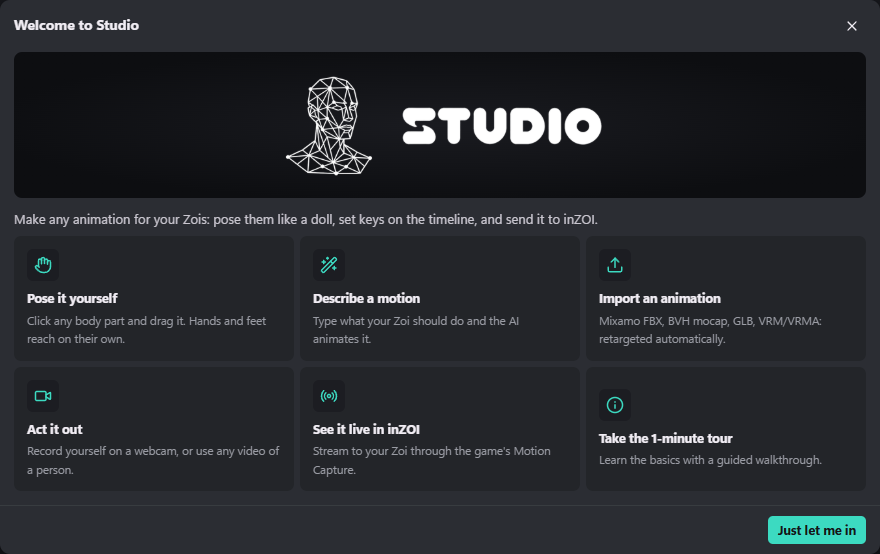

The first time, the **Welcome to Studio** screen offers six ways to start:

| Card | What it does |
|---|---|
| **Pose it yourself** | Closes the welcome screen so you can click a body part and drag it. |
| **Describe a motion** | Opens [Describe a motion](#11-describe-a-motion-ai): type what the Zoi should do and the AI animates it. |
| **Import an animation** | Opens the file picker for Mixamo FBX, BVH, GLB, VRM and VRMA files ([section 13](#13-import-animations-and-characters)). |
| **Act it out** | Opens the [webcam and video capture](#12-act-it-out-webcam-or-video). |
| **See it live in inZOI** | Opens the [live link](#20-live-in-inzoi). |
| **Take the 1-minute tour** | A six-step guided tour that highlights each area of the window. |

**Just let me in** closes the screen. To see it again, use the **?** button in the top-right corner, then **Start screen**.

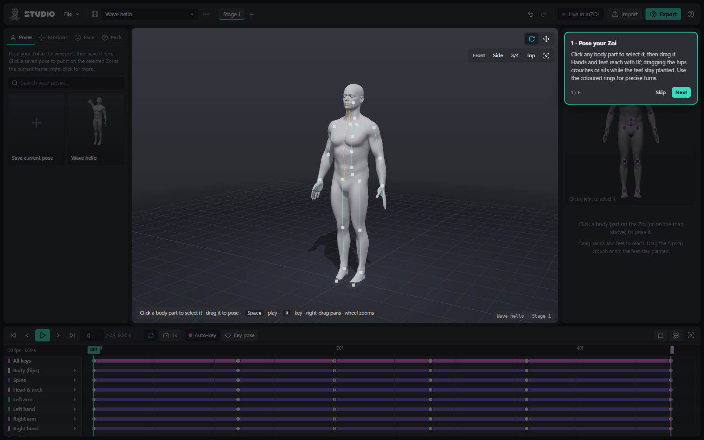

The tour moves on with **Next**, the right arrow key or Enter. **Skip** or Esc ends it.

---

## 3. The Studio window

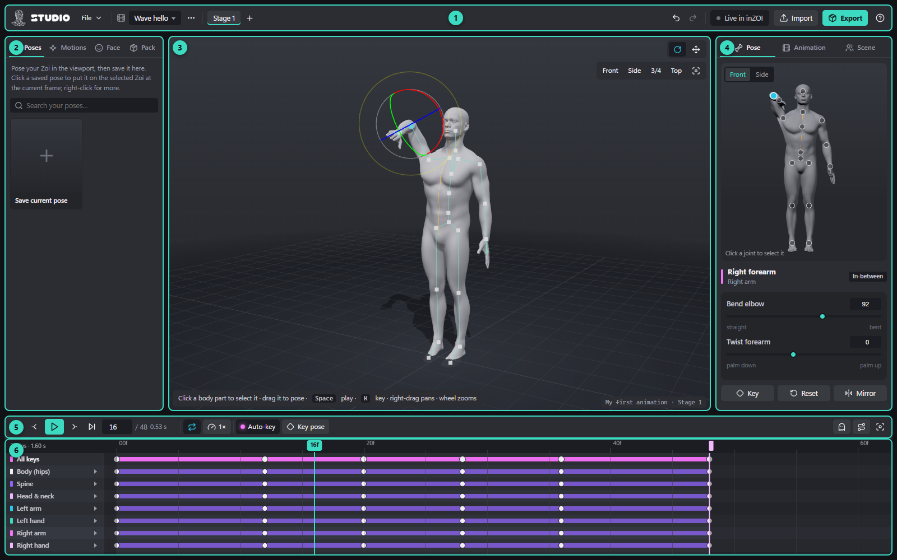

| # | Area | What it is for |
|---|---|---|
| 1 | **Top bar** | File menu, which animation and stage you are editing, undo and redo, the live link, Import and Export, and help. |
| 2 | **Library** | Your saved poses, the motion makers (AI, capture, import), face expressions and the pack's list of animations. |
| 3 | **Viewport** | The 3D view of your Zoi. Click and drag body parts to pose them. |
| 4 | **Inspector** | Exact sliders for the selected body part, the animation's settings and the Zois in the scene. |
| 5 | **Transport bar** | Play, step through frames and keys, loop, playback speed, Auto-key, onion skin and motion path. |
| 6 | **Timeline** | Every key of the selected Zoi, by body part. Retime, copy, ease and delete keys here. |

The timeline's height can be changed by dragging the thin handle along its top edge. Studio remembers the height.

### The top bar

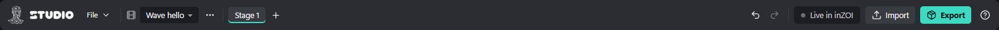

From left to right:

**File menu**

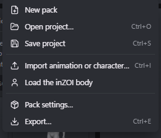

| Item | Shortcut | What it does |
|---|---|---|
| New pack | | Starts an empty pack. Studio asks first. **Save your current pack before you do this**: the new pack replaces your current work, including its autosave. |
| Open project… | Ctrl+O | Opens a `.zmotion` project. |
| Save project | Ctrl+S | Saves the pack to `Documents\Zoi Motion Studio\Projects\<pack name>.zmotion`. |
| Import animation or character… | Ctrl+I | See [section 13](#13-import-animations-and-characters). |
| Load the inZOI body | | Shows the game's own body-tracking Zoi on the selected Zoi (see [section 14](#14-characters-how-your-zoi-looks)). |
| Pack settings… | | Pack name, author, id, version and description (see [section 10](#pack)). |
| Export… | Ctrl+E | See [section 19](#19-export). |

**Animation picker:** the film icon and the drop-down with the current animation's name. It switches between the animations in your pack. Animations with several Zois show `(N Zois)` after the name.

**Animation options (`...`)**

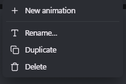

* **New animation**: adds an empty animation (`Animation N`) to the pack.
* **Rename…**: the name shown in the pack and the in-game menu.
* **Duplicate**: makes a copy named `<name> (copy)`.
* **Delete**: removes it after asking. This can be undone.

**Stage tabs**
* One tab per stage of the current animation: `Stage 1`, `Stage 2` and so on. A loop icon marks stages that loop.
* Click a tab to edit that stage. Right-click it for **Rename…**, **Duplicate stage**, **Move left**, **Move right** and **Delete stage**.
* The **+** next to the tabs adds a stage. See [section 15](#15-stages-animations-in-several-parts).

**Undo and Redo:** their tooltips say what will be undone or redone, for example "Undo Pose Right forearm (Ctrl+Z)".

**Live in inZOI:** the live link's status.
* It reads **Live in inZOI** when off and **Live: streaming** when on. It reads **Live: no bridge** when a send fails.
* The dot turns teal and pulses while streaming, and red on an error.
* Click it to open the [live dialog](#20-live-in-inzoi).

**Import** and **Export:** the same as Ctrl+I and Ctrl+E.

**? (Help)**
* **Quick tour**
* **Keyboard shortcuts** (also `?`)
* **How to get it into inZOI**
* **Start screen**

---

## 4. How an animation is organised

Studio works with four levels:

```
Pack                      what players install, e.g. "Cute Couple Animations"
 └─ Animation             one entry in the pack, e.g. "Wave hello" or "Hug"
     ├─ Zois              1 to 6 roles: Zoi A, Zoi B, ...
     └─ Stages            1 or more parts in order, e.g. "Approach" → "Hug loop" → "Let go"
         └─ Keys          per Zoi, per body part, per frame
```

* **Pack:** has a name, an author, a pack id, a version and a description. Everything you export from one project belongs to that pack.
* **Animation:** has a name, a type, inZOI settings, its Zois and its stages. In the in-game panel and in the pack file an animation is also called a **scene**.
* **Zoi (role):** each Zoi in an animation has its own keys. It also has a body size (adult, tall, teen or child), the gender and life stage it is meant for in the game, and its position and facing relative to Zoi A.
* **Stage:** a part of the animation with its own length, frame rate and loop setting. A simple animation has one stage.
* **Keys:** a key stores the rotation of a body part (and, for the hips, its position) on one frame. Between two keys Studio fills in the motion. How it moves from one key to the next is the key's **easing** (smooth, linear, ease in and out, hold…).

**Frames and frame rate.** A stage's length is counted in frames. At 30 frames per second (fps), 1 second is 30 frames. Frames are numbered from 0 to the last frame. The frame box in the transport bar shows the current frame and `/ N`, the last frame. Exports contain every frame from 0 to N.

**Auto-key.** With **Auto-key** on (the default), every change you make to the pose is saved as a key on the current frame straight away. With it off, your changes are only a preview until you press **K** (key the selected part) or **Shift+K** (key the whole pose).

---

## 5. Tutorial: your first animation

This tutorial builds a 1.6-second wave with the right hand. It takes about five minutes and uses most of the basic tools.

1. **Name it.** Open the **Animation** tab on the right. Set **Name** to `Wave hello` and **Type** to **Interaction / action**.
2. **Set the length.** In the same tab, under **Stage 1 of 1**, set **Frames** to `48`. At 30 fps that is 1.6 seconds.
3. **Make the starting pose (frame 0).** Check that the frame box at the bottom shows `0`.
   1. Click the Zoi's **left upper arm** in the viewport. Its sliders appear in the **Pose** tab. Set **Raise** to `-76` so the arm hangs down.
   2. Do the same for the **right upper arm**.
   3. Select each **forearm** and set **Bend elbow** to about `12`, so the arms are relaxed rather than stiff.
   4. Press **Shift+K** to key the whole pose on this frame. With Auto-key on, the parts you changed are already keyed; Shift+K makes sure every part has a key at frame 0.
4. **Raise the arm (frame 12).** Type `12` in the frame box, or press the right arrow key twelve times (Shift+right arrow moves 10 frames at a time).
   * **Right upper arm:** Raise `62`, Swing `18`.
   * **Right forearm:** Bend elbow `92`.
   * **Right hand:** Side bend `-22`.

   You can also simply **drag the right hand** up in the viewport: it reaches with IK, and the elbow and shoulder follow.
5. **Wave (frames 20, 28 and 36).** On frame 20 set the right hand's **Side bend** to `22`. On frame 28 set it back to `-22`, and on frame 36 to `22` again.
6. **Return to rest (frame 48).**
   1. Go to frame 0. Click an empty spot in the timeline so no keys are selected, then press **Ctrl+C** to copy the whole pose.
   2. Go to frame 48 and press **Ctrl+V**. The starting pose is pasted and keyed.
7. **Play it.** Press **Space**. The animation loops in Studio while **Loop** is on in the transport bar.
8. **Polish the timing.**
   * Drag keys left or right in the timeline to make a move faster or slower. A `+N frames` label shows how far you moved them.
   * Right-click a key and choose **Ease in & out** to make that move start and stop gently.
9. **Save.** Press **Ctrl+S**. The project goes to `Documents\Zoi Motion Studio\Projects`.

Next steps:
* to see the wave on your Zoi in the game right now, use [Live in inZOI](#20-live-in-inzoi);
* to make it permanent, follow [Getting your animations into inZOI](ANIMATIONS_IN_INZOI.md).

---

## 6. Posing in the viewport

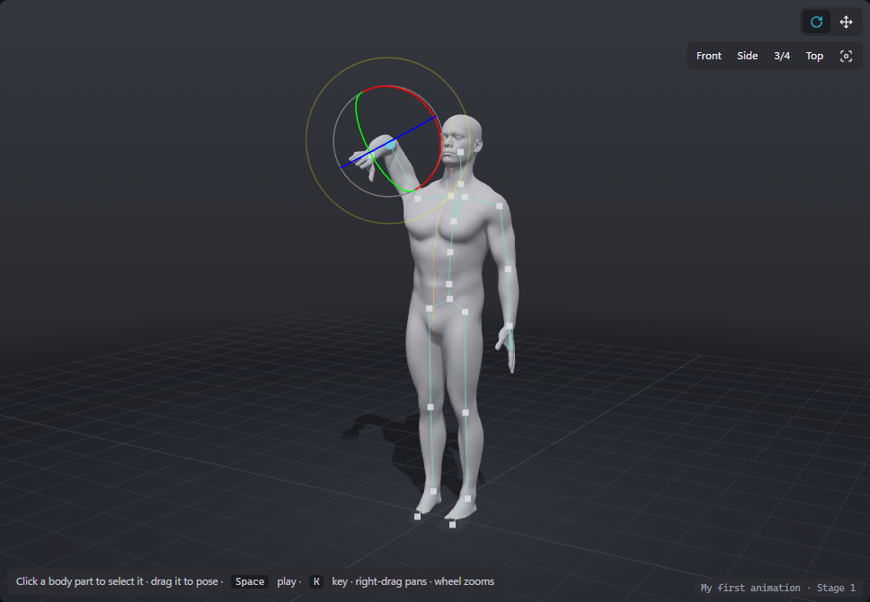

### Selecting

* **Click a body part** to select it. The part glows, and its sliders appear in the **Pose** tab on the right.
* **Hovering** a part highlights it and the hint bar at the bottom left of the viewport says what dragging will do.
* **Click empty space** (without dragging) to deselect. **Esc** also deselects.
* **Click another Zoi** to make it the active Zoi. In scenes with several Zois you can also click its chip at the top left of the viewport, or press **Tab**.
* Finger segments 2 and 3 are too small to click on a character model. Select them from the timeline: expand **Left hand** or **Right hand** and click the row label.

### Dragging

| Drag this | What happens |
|---|---|
| **A hand or a foot** | It **reaches** (IK): the elbow or knee bends on its own so the hand or foot follows your mouse. Feet keep their angle to the floor and hands keep their angle to the forearm. The reach stops at the full length of the arm or leg. |
| **Shift + a hand or a foot** | It **swings** around the wrist or ankle instead of reaching. |
| **The hips** | **Moves the whole body.** With *Keep feet planted when moving the hips* on (the default, in the Scene tab), the feet stay where they are, so pulling the hips down makes the Zoi crouch or sit. |
| **Any other part** | It **swings** around its joint so the point you grabbed follows the mouse. |

When you let go, the parts you moved are keyed (with Auto-key on) and the step goes into undo history as `Pose <part>`.

If Auto-key is off, the pose is only a preview. Studio shows *"Auto-key is off: press K to keep this pose."* once per session. **Moving to another frame or pressing Play throws away unkeyed changes**, so press K first.

### Rotate and Move tools

The two buttons at the top right of the viewport switch tools:

* **Rotate tool (E or R):** coloured rings around the selected part, in the part's own axes. Drag a ring to turn the part around that axis only. This is the most precise way to twist a forearm or tilt the head.
* **Move tool (W or G):**
  * on the **hips**, arrows that move the body along the floor or up and down (the feet stay planted if that option is on);
  * on **hands and feet**, arrows on an IK target: dragging them moves the hand or foot and the limb follows;
  * every other part still gets rotation rings.

The camera is locked while you drag a ring or arrow. Rings and arrows are hidden during playback.

### Camera

| Do this | Camera |
|---|---|
| Left-drag on empty space | Orbit around the Zoi |
| **Alt** + left-drag | Orbit, even over the Zoi |
| Right-drag | Pan |
| Middle-drag | Dolly in and out |
| Mouse wheel | Zoom |
| Double-click a body part | Focus on that part |
| **F** | Focus on the selected part (the hips if nothing is selected) |
| **Shift+F** | Frame every Zoi |
| **1 / 3 / 5 / 7** | Front / side / three-quarter / top view |

The view buttons (**Front**, **Side**, **3/4**, **Top**) and the focus button sit at the top right of the viewport. Views aim at the active Zoi's hips and follow the way it faces; **Side** looks at the Zoi's left side.

### Right-click a body part

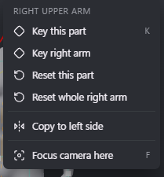

* **Key this part** (K)
* **Key \<group\>**, for example *Key right arm*: keys every part of that group.
* **Reset this part**: back to the rest pose.
* **Reset whole \<group\>**
* **Copy to left side** / **Copy to right side**: mirrors this group onto the other side. For arms it also copies the hand and the fingers.
* **Focus camera here** (F)

### The hint bar and status

* **Bottom left:** a one-line hint that changes with what you hover. By default it reads: *Click a body part to select it · drag it to pose · Space play · K key · right-drag pans · wheel zooms*.
* **Bottom right:** the current animation and stage, and while streaming, ` · live N pkts`.

---

## 7. The inspector (right panel)

The inspector has three tabs: **Pose**, **Animation** and **Scene**. Selecting a body part switches to the Pose tab.

### Pose tab

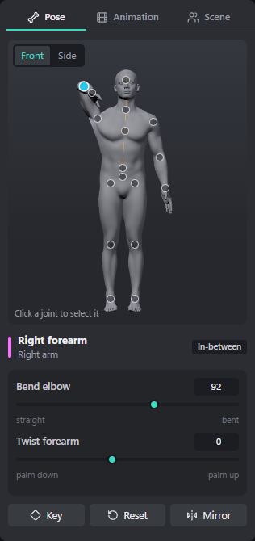

**Pose viewer.** A small live picture of the active Zoi, with **Front** and **Side** buttons.
* Click a joint dot to select that part.
* The selected dot is cyan. A dot with a pink ring has a key on the current frame.
* The viewer has dots for the head, neck, chest, spine, hips, arms, hands and legs. Fingers, shoulders and toes are selected in the viewport or the timeline.

**Part header.** The part's name, its group (for example *Right arm*) and a badge:

| Badge | Meaning |
|---|---|
| **Keyed** | This part has a key on this frame. |
| **In-between** | The part is between two keys; what you see is filled in by Studio. |
| **Not animated** | The part has no keys at all. |

**Sliders.** Each slider has a name, a number box and labels for both ends. Type an exact value or drag. The ranges are chosen so that the Zoi cannot bend into impossible shapes:

| Part | Sliders (low end ↔ high end, range in degrees) |
|---|---|
| Hips | Tilt (back ↔ forward, -60 to 90) · Lean (right ↔ left, -45 to 45) · Turn (right ↔ left, -180 to 180) |
| Lower spine, Chest, Upper chest | Bend (back ↔ forward, -60 to 90) · Lean (right ↔ left, -45 to 45) · Twist (right ↔ left, -60 to 60) |
| Neck, Head | Nod (up ↔ down, -50 to 60) · Turn (right ↔ left, -80 to 80) · Tilt (right ↔ left, -40 to 40) |
| Shoulder | Shrug (down ↔ up, -15 to 35) · Reach (back ↔ forward, -25 to 30) |
| Upper arm | Raise (down ↔ up, -85 to 90) · Swing (back ↔ forward, -60 to 120) · Twist (in ↔ out, -90 to 90) |
| Forearm | Bend elbow (straight ↔ bent, -5 to 150) · Twist forearm (palm down ↔ palm up, -90 to 120) |
| Hand | Flex wrist (down ↔ up, -70 to 70) · Side bend (back ↔ forward, -30 to 30) · Roll (in ↔ out, -45 to 45) |
| Index, middle, ring, pinky (segments 1 to 3) | Curl (open ↔ curled, -15 to 100) · Spread (in ↔ out, -25 to 25) |
| Thumb (segments 1 to 3) | Curl (open ↔ curled, -20 to 80) · Fold (up ↔ under palm, -30 to 60) · Twist (in ↔ out, -45 to 45) |
| Thigh | Lift leg (back ↔ forward, -40 to 130) · Spread (in ↔ out, -30 to 80) · Twist (in ↔ out, -45 to 45) |
| Shin | Bend knee (straight ↔ bent, -5 to 155) |
| Foot | Point (flex up ↔ point down, -40 to 60) · Roll (in ↔ out, -30 to 30) · Turn (in ↔ out, -30 to 30) |
| Toes | Bend toes (down ↔ up, -30 to 60) |

**Hips position** (hips only):

| Slider | Range |
|---|---|
| Height | -1 to 0.5 m |
| Forward | -1 to 1 m |
| Sideways | -1 to 1 m |

Releasing any of these always keys the hips, even with Auto-key off.

**Buttons**
* **Key** (K): key this part.
* **Reset**: back to the rest pose (keyed).
* **Mirror**: left and right parts only. Copies this side's group to the other side (keyed).

**Motion after this key.** Shown when the part has a key on this frame. Picks the key's easing, the way the part moves from this key to the next:

| Easing | Feels like |
|---|---|
| **Smooth (auto)** | Flows through the keys without overshooting them. The default and usually the best. |
| **Linear** | Constant speed, mechanical. |
| **Ease in & out** | Starts and stops gently. |
| **Ease in (speed up)** | Starts slowly and speeds up. |
| **Ease out (slow down)** | Starts fast and slows down into the next key. |
| **Overshoot** | Goes a little past the next key and settles back, for snappy, cartoony moves. |
| **Hold (snap)** | Stays still, then snaps to the next key's pose. |

New keys copy the easing of the key before them.

### Animation tab

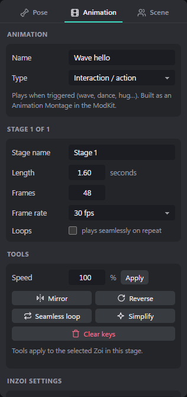

**Animation**
* **Name:** the name shown in the pack list, the exported file names and the in-game panel.
* **Type:** what kind of animation this is in inZOI. It changes the inZOI settings shown below and the instructions in the ModKit setup sheet.

| Type | Use it for | In the inZOI ModKit |
|---|---|---|
| **Interaction / action** | Something that plays when triggered: a wave, a dance, a hug. | Animation Montage, Character Animation → Interaction |
| **Pose (held)** | A still or gently looping pose for photos and idles. | Same as Interaction |
| **Walk / idle style** | A replacement for the default idle or walk. | Character Animation → Locomotion |
| **Mood walk / idle** | A walk or idle used while a stat or mood is active, such as tired or drunk. | Character Animation → Stat Locomotion |

**Stage X of Y**
* **Stage name**
* **Length** in seconds, and **Frames**. Change either one; the other follows. Changing the length does not move your keys. Keys past a new, shorter end stay in the stage but are not played or exported.
* **Frame rate:** 24, 30 or 60 fps. Changing it keeps the duration and re-times every Zoi in the stage.
* **Loops:** the stage repeats seamlessly in Studio and in the game. Ticking it does not make the motion itself seamless. Use the **Seamless loop** tool, or make the last pose match the first.
* **Plays** (only for looping stages): how many times it plays in the game. `-1` means until stopped.

**Tools**

| Tool | What it does |
|---|---|
| **Speed** % + **Apply** | Makes the stage faster or slower (10 to 400%). It re-times every Zoi in the stage. |
| **Mirror** | Flips the selected Zoi's animation left ↔ right. |
| **Reverse** | Plays the selected Zoi's animation backwards. |
| **Seamless loop** | Copies the first pose to the end so the loop has no pop. It also turns **Loops** on for the stage. |
| **Simplify** | Removes keys that are not needed. Very useful after an import, a capture or Describe a motion. |
| **Clear keys** | Removes every key of the selected Zoi in this stage, after asking. |

**inZOI settings.** These values are copied into the pack file and the ModKit setup sheet when you export.

| Setting | Shown for | Meaning |
|---|---|---|
| **Menu tags** | all | Comma-separated words players can search for, for example `dance, happy, couple`. |
| **Posture** | all | The posture the Zoi must be in: Stand, Sit, SitOnFloor, Lie, Kneel or Swim. |
| **Rate scale** | all | Playback speed in the game, 0.1 to 4. `1` is normal speed. |
| **Stat id** and **Stat value** | Mood walk / idle | The stat that triggers it, for example `Tired`, and its value. |
| **Emotion** and **Chance** | Walk / idle style | An optional emotion, for example `Happy`, and the chance of a random idle playing. |

### Scene tab

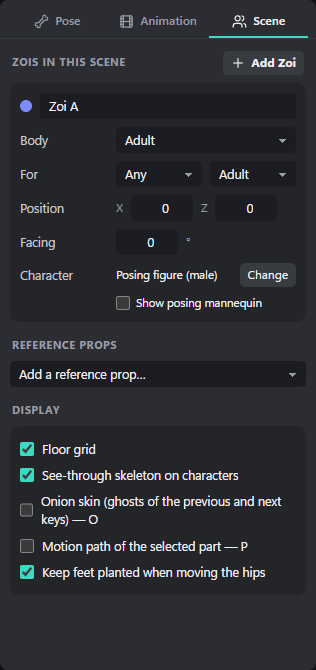

**Zois in this scene**, with an **Add Zoi** button. Each Zoi has a card; click a card to make that Zoi active.

| Field | Meaning |
|---|---|
| Name | The role's name, for example *Zoi A*. The coloured dot is its colour in the viewport chips. |
| Bin icon | Removes this Zoi and its animation (only when there are two or more). |
| **Body** | Adult, Adult (tall), Teen or Child. Changes the posing figure's size and proportions so contacts line up. |
| **For** | The gender (Any, Female, Male) and life stage (Adult, Teen, Child) this role is meant for in the game. Used by the ModKit setup sheet: *Any* becomes two entries, Female and Male; Teen roles use the Adult entries and Child roles use Default / Youth, as inZOI's own animations do. |
| **Position** | X (to the side) and Z (forward), in metres. |
| **Facing** | In degrees. 180 faces Zoi A. |
| **Character** | The look shown for this Zoi, and **Change** to pick another (see [section 14](#14-characters-how-your-zoi-looks)). |
| **Show posing mannequin** | Shown when a character model is loaded: also draws the jointed mannequin. |

Below the cards are **Reference props** and **Display** ([section 17](#17-reference-props-and-display-options)).

---

## 8. The timeline

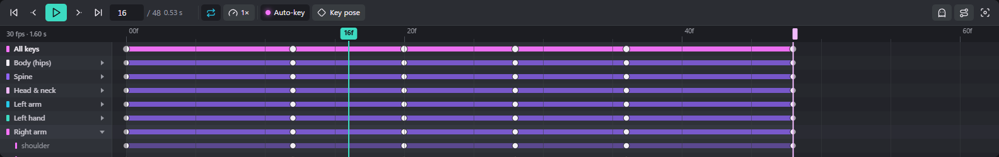

The timeline shows the keys of the **active Zoi** in the **current stage**.

### Rows

* **All keys:** a summary of every key, face keys included.
* One row per body group: **Body (hips)**, **Spine**, **Head & neck**, **Left arm**, **Left hand**, **Right arm**, **Right hand**, **Left leg**, **Right leg**, and **Face (live link)**.
* Click a group's label to **expand** it into one row per part, for example *upper arm*, *forearm*, *thumb 1*. **Body (hips)** expands into *Hips* (rotation) and *Hips position*.
* Click a part row's label to **select** that part.
* A coloured bar runs from the first to the last key of each row. The selected part's rows are highlighted.

### Keys

* Keys are white; selected keys are teal.
* The key's shape shows its easing: **square** = Hold, **diamond** = Linear, **circle** = Smooth, **rounded diamond** = any other easing.

### Ruler, playhead and end

* The ruler shows frame numbers (`00f`, `10f`…) and, on the left, `<fps> fps · <seconds> s`.
* The **teal playhead** marks the current frame.
* The **light pink bar** marks the last frame. Drag its tab in the ruler to change the stage length.

### Mouse

| Do this | Result |
|---|---|
| Click or drag in the ruler | Scrub through time |
| Click a key | Select it and jump to its frame. **Shift** or **Ctrl** adds to or removes from the selection. |
| Drag selected keys | Move them in time. A `+N frames` label shows the offset. |
| Click an empty area | Clear the selection and jump to that frame |
| Drag in an empty area | Box-select keys. **Shift** adds to the selection. |
| Double-click in a row | Jump there and key that row: a part row keys the part, a group row keys its parts, *All keys* keys the whole pose, an expression row keys that expression |
| Ctrl + wheel, or wheel over the ruler | Zoom in and out around the mouse |
| Shift + wheel, or horizontal scroll | Move through time |
| Wheel | Scroll the rows |

### Right-click menus

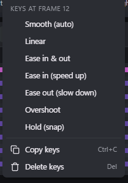

**On a key** (it is selected first): the seven easings, then **Copy keys** (Ctrl+C) and **Delete keys** (Del).

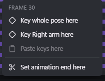

**On an empty area:**
* **Key whole pose here**
* **Key \<row\> here** (on body-part rows)
* **Paste keys here**
* **Set animation end here**

**On a row label:** **Track colour…** and **Default colour**.

### Track colours

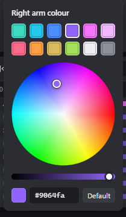

Every top-level row can have its own colour. Click the small colour chip at the left end of a row, or right-click the label and choose **Track colour…**. The picker has:
* 12 swatches;
* a colour wheel (drag to pick any colour) and a brightness slider;
* a hex box. Type a code such as `#3cdac1` and press Enter.

**Default** resets the colour. Changes show live; Esc or a click outside closes the picker. Colours are saved for you, not in the project.

### Copy and paste keys

* Select keys, press **Ctrl+C**, move the playhead, and press **Ctrl+V**. The keys are pasted starting at the playhead, keeping their spacing.
* Ctrl+V pastes keys only while some keys are selected in the timeline. With no keys selected it pastes a copied **pose** instead. **Paste keys here** in the right-click menu always pastes keys.
* **Del** (or Backspace) deletes the selected keys. Studio shows `Deleted N key(s).` with an **Undo** button.

---

## 9. The transport bar

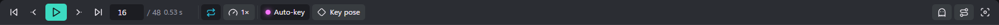

| Control | Shortcut | What it does |
|---|---|---|
| First frame | Home | Go to frame 0 |
| Previous key | ↓ | The previous key of the selected part, or of any part when nothing is selected |
| Play / pause | Space | |
| Next key | ↑ | |
| Last frame | End | |
| Frame box | | Type a frame number. Next to it: `/ N` (the last frame) and the time in seconds. |
| **Loop** | | Loop playback in Studio (on by default). A stage with **Loops** ticked always loops in Studio. |
| **All stages** | | Shown when the animation has two or more stages: plays every stage in order to preview the whole scene. |
| Speed (`1×`) | | Playback speed in Studio: 0.25×, 0.5×, 1×, 1.5× or 2×. It does not change the animation itself. |
| **Auto-key** | | Every pose change is saved as a key on the current frame. A dot shows when it is on. |
| **Key pose** | Shift+K | Key the whole pose on this frame |
| Unkeyed badge | | Appears when you changed the pose but it is not keyed yet |
| Onion skin | O | Ghosts of the previous key's pose (cyan) and the next key's pose (pink) |
| Motion path | P | The path of the selected part: a teal-to-pink line with gold dots on its key frames |
| Fit timeline | | Zooms the timeline so the whole stage fits |

While playing, posing is switched off and the rings, ghosts and paths are hidden.

---

## 10. The library (left panel)

The library has four tabs: **Poses**, **Motions**, **Face** and **Pack**. Studio remembers the last one you used.

### Poses

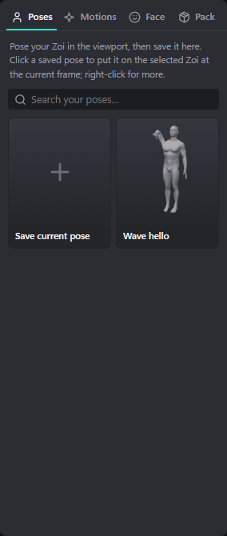

Your own pose collection. Studio ships no stock poses; you build the collection yourself.

* **Save current pose** stores the active Zoi's current pose under a name you choose. It appears as a 3D thumbnail.
* **Click a pose** to put it on the selected Zoi at the current frame. The whole body is keyed.
* The small corner button on a pose applies it **mirrored** (left ↔ right).
* **Right-click a pose** for **Apply**, **Apply mirrored**, **Rename…** and **Delete**.
* The search box filters your poses by name.

Saved poses are kept on your PC, not inside a project, so you can use them in every pack. The hips position is stored relative to the rest pose.

### Motions

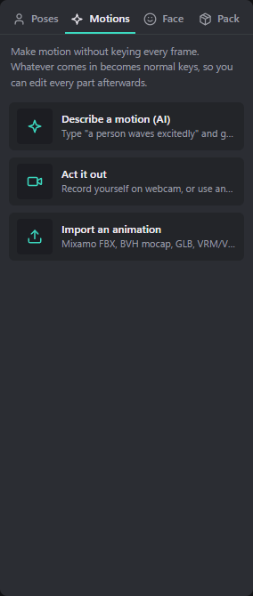

Three ways to make motion without keying every frame. Each creates normal keys that you can edit afterwards.

* **Describe a motion (AI):** type what the Zoi should do ([section 11](#11-describe-a-motion-ai)).
* **Act it out:** record yourself on a webcam, or use a video ([section 12](#12-act-it-out-webcam-or-video)).
* **Import an animation:** Mixamo FBX, BVH mocap, GLB, VRM or VRMA ([section 13](#13-import-animations-and-characters)).

### Face

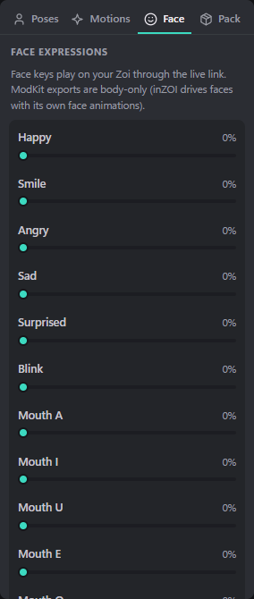

Eleven expression sliders: **Happy**, **Smile**, **Angry**, **Sad**, **Surprised**, **Blink**, and the mouth shapes **Mouth A**, **Mouth I**, **Mouth U**, **Mouth E** and **Mouth O**.

* Dragging a slider previews it. Releasing keys it on the current frame, whatever the Auto-key setting. The first face key also adds a 0 key at frame 0.
* Face keys appear in the timeline under **Face (live link)**.
* **Face keys only play through the live link.** Exports are body-only, because inZOI drives faces with its own face animations.

### Pack

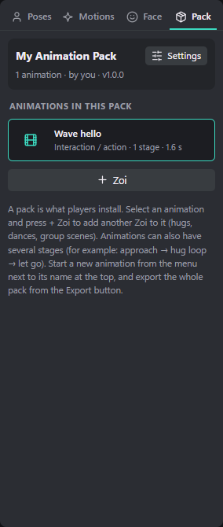

* **The pack card:** the pack's name, `N animations · by <author> · v<version>`, and a **Settings** button.
* **Animations in this pack:** one row per animation, with its type, number of stages and length.
  * Two-people icons mark multi-Zoi animations, footprints mark walk and idle types, one person marks poses, and a film icon marks interactions.
  * Click a row to edit that animation. Right-click it for **Duplicate** and **Delete**.
* **+ Zoi:** adds another Zoi to the current animation, for hugs, dances and group scenes (up to 6). See [section 16](#16-scenes-with-several-zois).

**Pack settings**

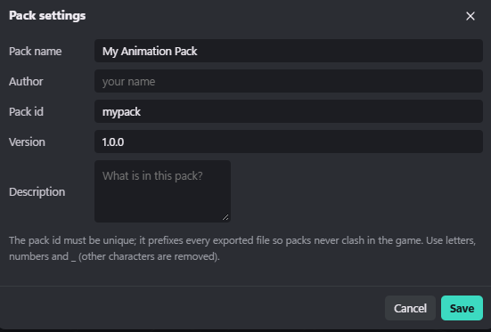

| Field | Example | Notes |
|---|---|---|
| **Pack name** | Cute Couple Animations | Shown to players |
| **Author** | your name | |
| **Pack id** | `yourname_couple` | Must be unique across all packs. It prefixes every exported file. Use letters, numbers and `_`; other characters, including dots, are removed when you save. It is stored in lower case. If you leave it empty, Studio builds one from the author and pack name. |
| **Version** | 1.0.0 | Raise it when you release an update |
| **Description** | | What is in the pack |

---

## 11. Describe a motion (AI)

Describe a motion turns a sentence like *"a person waves with the right hand, then bows"* into a new, fully editable animation.

It runs entirely on your PC with **MSFlow**, an open text-to-motion model by LY Corporation. Your text never leaves your computer.

### Open it

* **Library → Motions → Describe a motion (AI)**, or
* the **Describe a motion** card on the welcome screen.

### The AI's state

When the AI is not ready yet, a card at the top of the dialog says what it is doing:

| Card title | What is happening | What to do |
|---|---|---|
| *(no card)* | The AI is ready. | Describe your motion and press **Generate**. |
| **Starting the AI** | The AI is loading in the background. This happens the first time you use it after opening Studio and takes up to a minute (about 20 seconds on an RTX 4080). | Wait, or type your description meanwhile. Pressing Generate now waits for it. |
| **Downloading the AI model** | The AI is being downloaded and set up. A progress bar shows how far along it is. | Keep working; the card updates by itself. |
| **The AI model is not downloaded yet** | The AI was skipped during install, or its download failed. If it failed, the card says why. | Click **Download AI model**. Studio downloads it in the background (about 4 GB with an NVIDIA card, about 1 GB without). You can keep working meanwhile. |
| **The AI could not start** | The AI files are there, but the model failed to load. | See [Troubleshooting](#24-troubleshooting). |
| **AI not included** | This copy of Studio has no AI files. | Install Studio with Setup. |
| **Studio's helper is not running** | Studio was opened as a plain web page without its helper. | Open Studio from the Start menu, or use `Start Studio.bat`. |

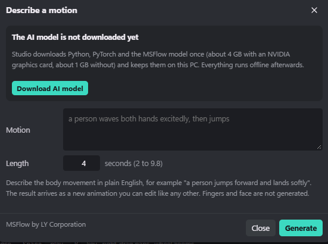

### Make a motion

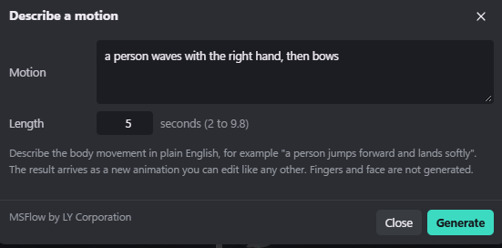

1. **Motion:** describe the body movement in plain English.
2. **Length:** 2 to 9.8 seconds. Choose a length that suits the action; see the table below.
3. Press **Generate**. A progress line shows *Waking up the AI*, *Generating the motion*, *Building the animation*, then *Done*. On an RTX 4080 a 5-second motion takes about 2 to 3 seconds. Without an NVIDIA card it runs on the processor and takes much longer.
4. The dialog closes. The new animation is added to your pack, opened at frame 0 and named after your text. Studio says *Added "\<name\>". Press Space to play it.*

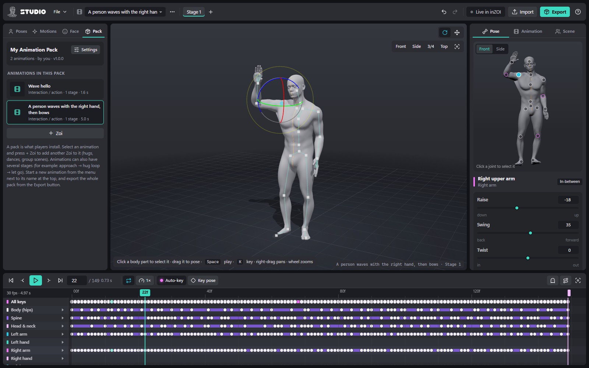

**Every Generate gives a different take.** The AI starts from a new random seed each time, so pressing Generate again with the same text gives another variation. Make a few and keep the best. Delete the rest from the Pack tab (right-click → Delete).

Studio remembers your last description and length.

### What you get

* A **new animation** with one Zoi and one stage, of type *Interaction / action*, not looping. It fits the active Zoi's body size.
* Keys for the **hips (rotation and travel), spine, chest, neck, head, shoulders, arms and legs**, at the stage's frame rate (30 fps unless you changed it). The AI works at 20 fps, and Studio converts the result.
* **No keys for the hands, fingers, toes or face.** The AI does not generate them. Pose the hands yourself afterwards; this is often what makes a motion look finished.
* The motion **travels**: if you asked for a walk, the hips really move forward. When you export, choose **Movement: In place** if the motion should stay on the spot (see [section 19](#19-export)).

### Writing good descriptions

MSFlow learned from thousands of short motion-capture clips described in plain English, and it does best with similar sentences.

* **Start with "a person".** For example, *"a person jumps forward and lands softly"*.
* **Describe the body, not the story.** Say what the arms, legs and body do: *"raises both arms above the head"* rather than *"celebrates"*. Style words still help: *slowly*, *quickly*, *happily*, *carefully*, *like a zombie*.
* **Keep it to one to three actions, in order,** joined with *then*: *"a person walks forward, then turns around and sits down"*.
* **Say which side:** *"with the right hand"*, *"kicks with the left leg"*.
* **Give directions:** *forward*, *backward*, *to the left*, *in a circle*, *turns around*.
* **Match the length to the action.** Too short squeezes the motion; too long makes the AI pad it with idle movement.
* **Things the AI cannot do:**
  * fingers and hand shapes (a peace sign, a point);
  * facial expressions;
  * two people interacting: it makes one person only, so for a hug, generate each role separately or pose it yourself;
  * objects. It imagines chairs and steps, so *"sits down on a chair"* works. Place a Chair [reference prop](#17-reference-props-and-display-options) to line the result up.

**Examples to start from**

| Idea | Description | Length |
|---|---|---|
| Wave | a person waves with the right hand | 3 s |
| Greeting | a person waves with the right hand, then bows | 5 s |
| Cheer | a person raises both arms above the head and jumps twice | 3–4 s |
| Dance | a person dances happily, swinging the arms side to side | 6–8 s |
| Sit down | a person walks forward and sits down on a chair | 6 s |
| Stretch | a person stretches both arms up, then bends forward to touch the toes | 6 s |
| Tired walk | a person walks forward slowly and tiredly, dragging the feet | 6 s |
| Kick | a person kicks forward with the right leg | 3 s |
| Stumble | a person stumbles forward and almost falls, then catches the balance | 4 s |
| Look around | a person stands and looks around to the left and to the right | 5 s |

### Cleaning up a generated motion

The result is ordinary keys, so everything in this guide applies to it. A good routine:

1. **Play it** (Space) and decide whether to keep it or generate another take.
2. **Trim it.** Drag the end bar in the ruler, or right-click → **Set animation end here**.
3. **Simplify** (Animation tab → Tools) to thin out keys. This makes the motion easier to edit.
4. **Pose the hands** on a few key frames: a relaxed curl, an open wave, a fist.
5. **Fix contacts.** Feet that slide or hands that miss a prop can be fixed by dragging the hand or foot (IK) on the frames where it matters.
6. **Loop it** if needed: tick **Loops** and use **Seamless loop**.
7. **Rename it** (Animation tab → Name).

### Privacy and licence

* The AI runs on your own PC. Studio sends your description to the AI over a private connection inside your computer, never to the internet. Once the AI is downloaded, Describe a motion works offline.
* The AI is credited in the dialog: *MSFlow by LY Corporation*. Its code is CC0 and its model weights are Apache-2.0. The text encoder is DistilBERT (Apache-2.0).

---

## 12. Act it out (webcam or video)

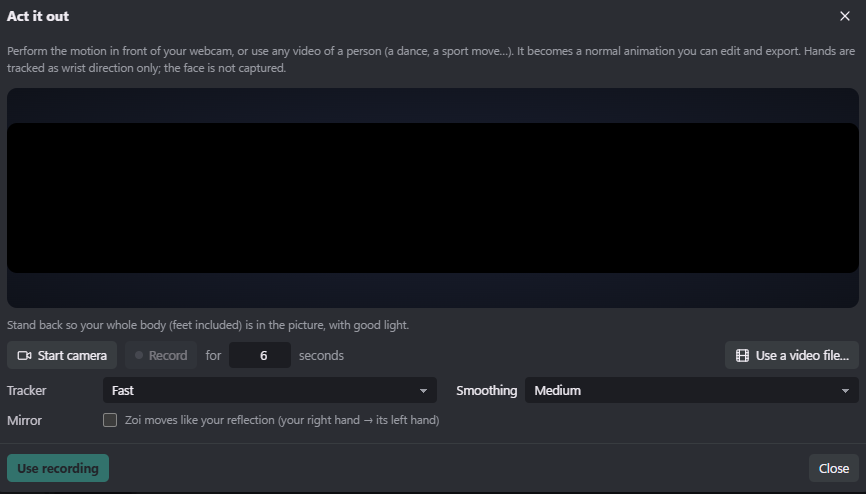

Act it out turns a recording of a real person into an animation. Use your webcam, or any video of a person: a dance, a sport move, a clip of yourself.

**Webcam**
1. Click **Start camera**. The first time, Studio downloads the pose tracker (Google's MediaPipe); it needs the internet for this. You will see *"Loading the pose tracker (first time takes a few seconds)…"*.
2. Stand back so your **whole body, feet included**, is in the picture, with good light. Your Zoi copies you live. If the live link is on, your Zoi in inZOI copies you too.
3. Set **Record for** 2 to 30 seconds (default 6) and click **Record**. A 3-2-1 countdown runs, then *Recording… X.X s*. Recording stops by itself.
4. Studio reports how many frames it tracked, for example *Recorded 6.0 s (97% of frames tracked)*. Record again, or click **Use recording**.

**Video**
1. Click **Use a video file…** and pick an MP4 (H.264) or WebM file.
2. Studio processes it with a progress bar, then reports *Processed X.X s of video (NN% of frames had a person).*
3. Click **Use recording**.

**Options**

| Option | Choices | Notes |
|---|---|---|
| **Tracker** | Fast / Accurate (slower) | Accurate is better for fast moves and videos. Choose it before you start the camera. |
| **Smoothing** | None / Light / Medium (default) / Strong | Removes jitter. Strong is easiest to edit but softens sharp moves. |
| **Mirror** | on / off | On: the Zoi moves like your reflection (your right hand moves its left hand). |

**Use recording** adds a new animation at 30 fps, named after the video file or *Captured motion*. Closing the dialog without using a take restores your Zoi's pose.

Limits: hands are tracked as wrist direction only, so fingers are not captured, and the face is not captured. A recording cannot be stopped early. Clean the result up the same way as an AI motion ([section 11](#cleaning-up-a-generated-motion)).

---

## 13. Import animations and characters

Open the importer with **Import** in the top bar, **Ctrl+I**, **File → Import animation or character…**, or by **dropping a file** onto the window.

| Format | Typical source |
|---|---|
| **FBX** | Mixamo, Unreal, Blender, the inZOI ModKit |
| **GLB / glTF** | Blender, web 3D tools |
| **VRM** | VRoid and VRM characters, inZOI's body-tracking model |
| **VRMA** | VRM Animation files |
| **BVH** | Motion-capture libraries |
| **.zmotion** | Studio projects (opened as a project, not imported) |

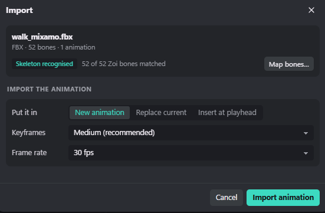

**The file card** shows the file's format, bone count and number of animations, and whether it contains a character mesh. Below it:
* **Skeleton recognised**, or *N key bones not found*.
* *N of 52 Zoi bones matched*. Studio understands Unreal, Mixamo, VRM, Blender-style and common mocap bone names.
* **Map bones…** opens the bone mapping table.

**Import the animation**

| Setting | Choices |
|---|---|
| **Animation** | Which animation to take, when the file has several |
| **Put it in** | **New animation** (a new 1-Zoi animation named after the clip) · **Replace current** (replaces the active Zoi's body keys; face keys are kept) · **Insert at playhead** (overwrites keys from the playhead on, extending the stage if needed) |
| **Keyframes** | **Keep every frame (exact)** · **Light clean-up** · **Medium (recommended)** · **Strong (easiest to edit)**. Clean-up removes keys that are not needed and switches the rest to smooth easing. |
| **Frame rate** | 24, 30 or 60 fps (defaults to the current stage's rate) |

Click **Import animation**. Studio says *Imported "\<name\>" (N frames). Everything is editable now.* If the clip's last pose matches its first, Studio marks the stage as looping.

**Map bones.** If the skeleton is not recognised, or an imported motion looks twisted, open **Map bones…**.
* Each of the 52 Zoi body parts has a drop-down where you pick the matching bone in the file.
* **Orange rows** are needed for a good result: hips, spine, head, and both upper arms, forearms, hands, thighs, shins and feet.
* Fingers and toes are optional.
* Click **Use this mapping**.

**Use as character.** If the file contains a skinned character, **Use as character** shows that model on the active Zoi instead of the posing figure. This is how you load the inZOI ModKit's Zoi skeleton for exact exports; see [Getting your animations into inZOI](ANIMATIONS_IN_INZOI.md#3-load-the-zoi-skeleton-once).

If the file contains neither an animation nor a skinned character, the dialog says so.

---

## 14. Characters: how your Zoi looks

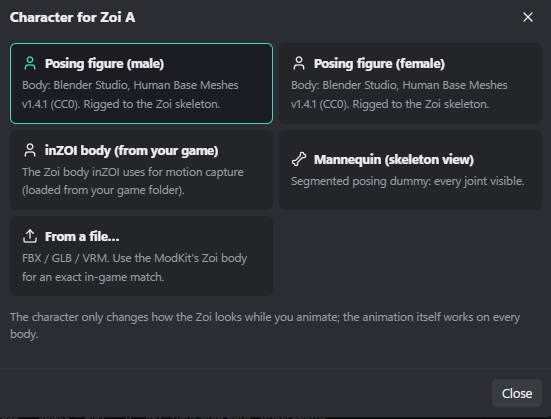

Click **Change** next to *Character* in the Scene tab to pick a look for the selected Zoi:

| Look | Notes |
|---|---|
| **Posing figure (male)** | The default. A realistic grey anatomical figure with a thin centre line. |
| **Posing figure (female)** | The same style, female body. |
| **inZOI body (from your game)** | Only listed when inZOI is installed. The Zoi body inZOI uses for motion capture, loaded from your own game folder. It is never copied or redistributed. |
| **Mannequin (skeleton view)** | A jointed posing dummy with every joint visible. Its joints are colour-coded: left side blue, right side pink, centre lavender. |
| **From a file…** | Your own FBX, GLB or VRM character, or the ModKit's Zoi body for an exact in-game match. |

The look only changes how the Zoi appears while you animate. The animation itself works on every body.

**See-through skeleton.** On a character model, Studio draws the skeleton through the body (teal lines and white joints) so you can see exactly which joint you grab. Turn it off under *Display* in the Scene tab.

**File → Load the inZOI body** switches the selected Zoi to the inZOI body straight away when Studio has found the game. If it has not, a dialog asks you to pick the file yourself:

```
…\steamapps\common\inZOI\Guides\MotionCapture\BodyTrackingVrm.vrm
```

Characters loaded from a file are not kept when you restart Studio. After a restart that Zoi shows the posing figure again, so load the file again if you need it.

---

## 15. Stages: animations in several parts

Many in-game animations come in parts: walk up, hug (looping while the player waits), let go. In Studio each part is a **stage**.

* **Add a stage:** click **+** next to the stage tabs. The new stage goes after the current one, with the same length, frame rate and loop setting. Each Zoi starts it with a key holding the pose the previous stage ended on, so the parts join up.
* **Rename, duplicate, reorder, delete:** right-click a stage tab.
* **Edit a stage:** click its tab. The timeline, the Animation tab's stage settings and playback all apply to that stage.
* **Preview the whole scene:** turn on **All stages** in the transport bar and press Space.

A typical three-stage hug:

| Stage | Name | Loops | Plays |
|---|---|---|---|
| 1 | Approach | no | |
| 2 | Hug loop | yes | `-1` (until the player stops it) |
| 3 | Let go | no | |

On export, Studio labels stages with the montage section names inZOI uses: **Default** before the loop, **Loop** for the first looping stage, and **End** after it. Each stage of each Zoi becomes its own animation file. Details are in [Getting your animations into inZOI](ANIMATIONS_IN_INZOI.md#stages-in-the-game).

---

## 16. Scenes with several Zois

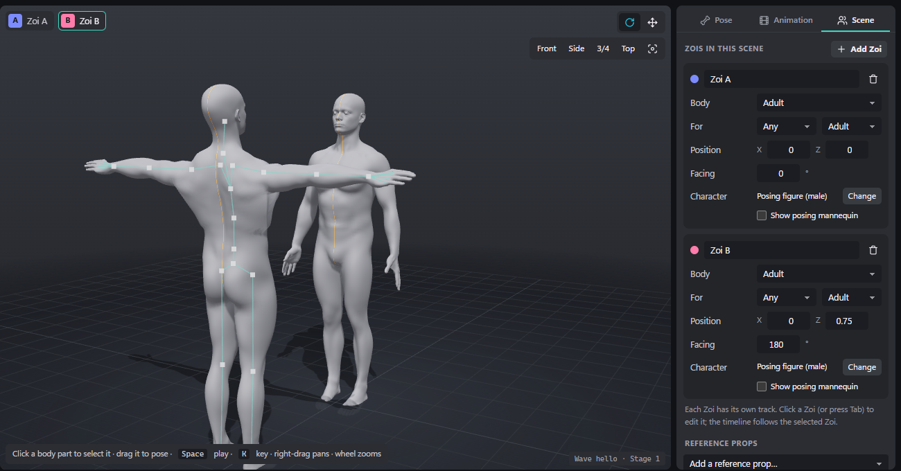

Hugs, handshakes, dances and group photos need several Zois animated together.

1. Open the animation and click **+ Zoi** (Pack tab) or **Add Zoi** (Scene tab). Up to 6 Zois fit in one animation. Studio says *Added a Zoi. Drag its hips, or set its position in the Scene tab.*
2. The new Zoi is placed 0.75 m in front of Zoi A, facing it (180°). Each further Zoi is placed another 0.75 m along.
3. **Pick the Zoi to edit** by clicking it, clicking its chip at the top left of the viewport, or pressing **Tab** (Shift+Tab goes back). The timeline always shows the selected Zoi's keys.
4. **Place them** with **Position** (X, Z) and **Facing** in the Scene tab, or drag a Zoi's hips.
5. Set each Zoi's **Body** (adult, tall, teen, child) so heights and contacts match. Set **For** (gender and life stage) to say which Zois can play that role in the game.
6. Animate each Zoi in turn on the same timeline. Onion skin and **All stages** help to check the timing between them.

**Keep Zoi A at position 0, 0, facing 0°.** The game places every other Zoi relative to Zoi A, and it ignores Zoi A's own offset.

To remove a Zoi, click the bin icon on its card. Studio asks first; this can be undone.

---

## 17. Reference props and display options

**Reference props** (Scene tab) help you line up contact animations:
* **Chair**, **Sofa**, **Double bed**, **Table**, **Counter**, **Step / stair**, **Wall** and **Bar stool**.
* Pick one from **Add a reference prop…**. Each prop has X, Z (metres) and rotation (degrees), and an **x** to remove it.
* Props are only a guide in Studio. They are saved with your project but never exported, since the game has its own furniture.

**Display** (Scene tab):

| Option | Default | |
|---|---|---|
| Floor grid | on | |
| See-through skeleton on characters | on | |
| Onion skin (ghosts of the previous and next keys) | off | Also **O** |
| Motion path of the selected part | off | Also **P** |
| Keep feet planted when moving the hips | on | |

---

## 18. Save, open, autosave and undo

* **Save project (Ctrl+S)** writes `Documents\Zoi Motion Studio\Projects\<pack name>.zmotion`. Studio says *Saved to …* with a **Show** button that opens the folder. Saving again overwrites the same file. To keep a separate copy, change the pack name in Pack settings first.
* **Open project (Ctrl+O)** opens a `.zmotion` file. You can also drop a `.zmotion` file onto the window.
* **Autosave:** Studio saves your work automatically about a second after every change. When you open Studio again it says *Restored your last session.*
* **Undo (Ctrl+Z) and Redo (Ctrl+Y or Ctrl+Shift+Z):** up to 120 steps. Studio says what it undid, for example *Undid: Pose Right forearm*. History is cleared when you open a project or start a new pack.

A `.zmotion` project holds the whole pack: every animation, stage, Zoi and key, your props and inZOI settings. It is also written into every inZOI pack export (`Source\<pack id>.zmotion`), so anyone with the export can open and edit the pack. The format is documented in [PACK_FORMAT.md](PACK_FORMAT.md).

---

## 19. Export

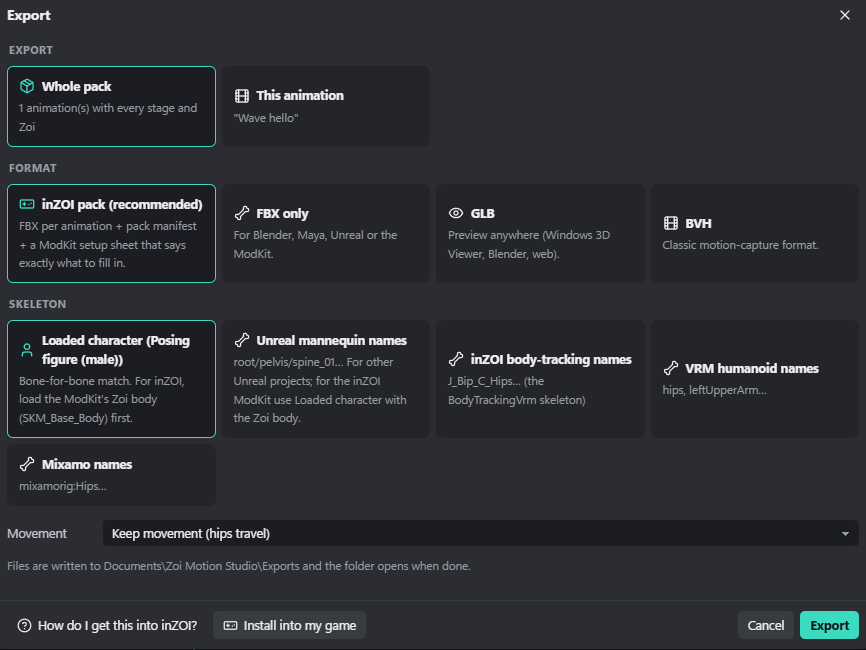

Open it with **Export** in the top bar, **Ctrl+E** or **File → Export…**.

**Export:** **Whole pack** (every animation, stage and Zoi) or **This animation**.

**Format**

| Format | Contains | Use it for |
|---|---|---|
| **inZOI pack (recommended)** | One FBX per animation, stage and Zoi, plus `zaf_pack.json`, `ModKit setup sheet.html`, `README.txt` and `Source\<pack id>.zmotion` | Making an inZOI mod |
| **FBX only** | The FBX files | Blender, Maya, Unreal or the ModKit |
| **GLB** | Animation plus the mannequin mesh, viewable anywhere | Previews in Windows 3D Viewer, Blender, the web |
| **BVH** | Classic motion-capture files, in centimetres | Other animation tools |

**Skeleton** (inZOI pack, FBX and BVH): which bone names and rest pose the files use.

| Skeleton | Bone names | When to use it |
|---|---|---|
| **Loaded character (\<name\>)** | The loaded character's own bones and rest pose | **Use this with the inZOI ModKit's Zoi skeleton loaded** (see below). |
| **Unreal mannequin names** | `root`, `pelvis`, `spine_01`… | Other Unreal projects. **Not for the inZOI ModKit:** the Zoi skeleton uses the same names but different bone axes, so the Zoi comes out twisted. |
| **inZOI body-tracking names** | `J_Bip_C_Hips`… | The BodyTrackingVrm skeleton |
| **VRM humanoid names** | `hips`, `leftUpperArm`… | VRM tools |
| **Mixamo names** | `mixamorig:Hips`… | Mixamo-rigged characters |

> **Important:** the built-in posing figures count as loaded characters, so **Loaded character (Posing figure (male))** is selected by default. That writes the posing figure's own skeleton, not inZOI's. For files meant for the inZOI ModKit, first load the ModKit's Zoi skeleton on every Zoi (**Import → Use as character**), then export with **Loaded character**. See [Getting your animations into inZOI](ANIMATIONS_IN_INZOI.md#3-load-the-zoi-skeleton-once).

**Movement**
* **Keep movement (hips travel):** the hips move through space as animated.
* **In place (remove forward/sideways travel):** the hips stay over the starting point. Up and down movement is kept. Use it for walk cycles and anything the game should move itself.

**Where the files go.** Studio writes them to `Documents\Zoi Motion Studio\Exports\<pack id>\` and opens the folder. Exporting again overwrites files with the same names but never deletes old ones.

Files are named `<pack id>_<Animation_name>`. Studio adds `_s1`, `_s2`… when the animation has several stages, and `_a`, `_b`… when it has several Zois. For example:
* `yourname_couple_Wave_hello.fbx`
* `yourname_couple_Hug_s2_b.fbx` (stage 2, Zoi B)

Give every animation a different name: two animations with the same name would overwrite each other's files.

**Footer buttons**
* **How do I get this into inZOI?** opens a short guide (also under **?** → *How to get it into inZOI*):

  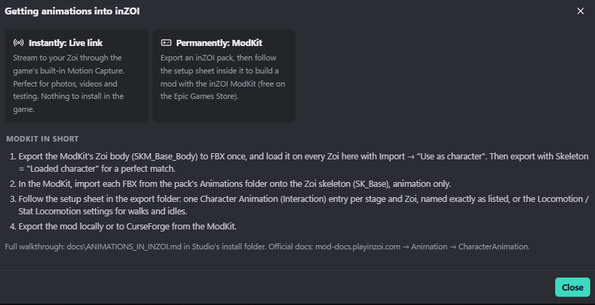

* **Install into my game** adds the pack to the in-game Animations panel. Both are explained in [Getting your animations into inZOI](ANIMATIONS_IN_INZOI.md).

Studio remembers your export choices.

---

## 20. Live in inZOI

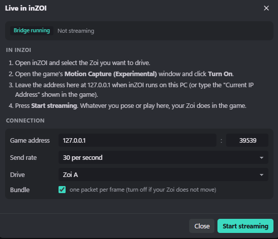

The live link plays whatever is on screen in Studio on your Zoi in the running game, through inZOI's built-in **Motion Capture** feature. That includes posing, playing, scrubbing and webcam capture. Nothing needs to be installed in the game.

1. Open inZOI and select the Zoi you want to drive.
2. In the game, open **Motion Capture (Experimental)** and click **Turn On**.
3. In Studio, click **Live in inZOI** in the top bar.
4. Leave **Game address** at `127.0.0.1` and port `39539` when inZOI runs on the same PC. For another PC, type the *Current IP Address* shown in the game.
5. Press **Start streaming**. Studio says *Live link on: your Zoi in inZOI now follows the studio.*

| Setting | Default | Notes |
|---|---|---|
| **Send rate** | 30 per second | 24, 30 or 60 |
| **Drive** | the active Zoi | Which of the scene's Zois to stream. The live link drives one Zoi at a time. |
| **Bundle** | on | Sends one network packet per frame. Turn it off if your Zoi does not move. |

The status bar shows the number of packets sent. The live link sends the body and the face expressions. It is not permanent: the Zoi returns to normal when you stop streaming. Full details are in [Getting your animations into inZOI](ANIMATIONS_IN_INZOI.md#2-live-link-see-it-in-the-game-now).

---

## 21. Keyboard and mouse reference

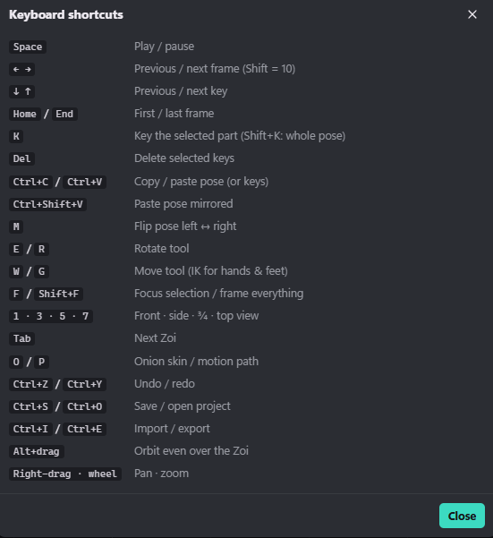

Shortcuts do nothing while a dialog is open or while you type in a box.

**Playback and time**

| Key | Action |
|---|---|
| Space | Play / pause |
| ← / → | Previous / next frame |
| Shift + ← / → | 10 frames back / forward |
| ↓ / ↑ | Previous / next key |
| Home / End | First / last frame |

**Keys and poses**

| Key | Action |
|---|---|
| K (or I) | Key the selected part. With nothing selected, key the whole pose. |
| Shift+K | Key the whole pose |
| Del / Backspace | Delete the selected keys |
| Ctrl+C | Copy the selected keys. With no keys selected, copy the whole pose. |
| Ctrl+V | Paste keys at the playhead while keys are selected, otherwise paste the copied pose |
| Ctrl+Shift+V | Paste the pose mirrored |
| M | Flip the whole pose left ↔ right (keyed) |

**Tools and view**

| Key | Action |
|---|---|
| E or R | Rotate tool |
| W or G | Move tool (IK for hands and feet) |
| F | Focus on the selected part |
| Shift+F | Frame every Zoi |
| 1 / 3 / 5 / 7 | Front / side / three-quarter / top view |
| O | Onion skin |
| P | Motion path |
| Tab / Shift+Tab | Next / previous Zoi |
| Esc | Deselect the part and clear the key selection |

**Files and history**

| Key | Action |
|---|---|
| Ctrl+Z | Undo |
| Ctrl+Y or Ctrl+Shift+Z | Redo |
| Ctrl+S / Ctrl+O | Save / open project |
| Ctrl+I / Ctrl+E | Import / export |
| ? or H | Keyboard shortcuts |

**Mouse in the viewport:** click to select · drag to pose · Shift+drag a hand or foot to swing it · Alt+drag to orbit · right-drag to pan · middle-drag to dolly · wheel to zoom · double-click to focus · right-click a part for its menu.

**In dialogs:** Esc closes; Enter presses the main button.

---

## 22. What Studio remembers

Studio keeps these on your PC between sessions; they are not part of a project:

* Auto-key, onion skin and motion path.
* The live link settings.
* The library and inspector tabs you last used.
* Your saved poses and track colours.
* The timeline height.
* Your export choices.
* Your last Describe a motion text and length.
* Your Act it out settings.
* Whether you have seen the welcome screen.

The floor grid, see-through skeleton and *keep feet planted* options reset to on each time Studio opens.

---

## 23. Limits

| Item | Limit |
|---|---|
| Zois per animation | 6 |
| Undo steps | 120 |
| Frame rates | 24, 30, 60 fps |
| Speed tool | 10 to 400% |
| Playback speeds | 0.25×, 0.5×, 1×, 1.5×, 2× |
| Describe a motion length | 2 to 9.8 seconds |
| Act it out recording | 2 to 30 seconds |
| Rate scale (inZOI setting) | 0.1 to 4 |

---

## 24. Troubleshooting

**Studio does not open, or opens a blank window**
* Check that the Microsoft Edge WebView2 Runtime is installed (Windows Settings → Apps → Installed apps → *Microsoft Edge WebView2 Runtime*). When it is missing, Studio shows Microsoft's download link.
* Studio allows one window at a time. If it seems not to start, look for an open Studio window on the taskbar.

**Describe a motion says "The AI model is not downloaded yet"**
* Click **Download AI model**. If it was tried before and failed, the card shows the reason.
* The setup log is at `%LOCALAPPDATA%\Programs\Zoi Motion Studio\ai\runtime\setup.log`.
* The usual causes are a dropped internet connection and too little disk space (the setup needs 8 GB free with an NVIDIA card, 3 GB without). Interrupted downloads resume where they stopped when you try again.

**Describe a motion says "The AI could not start"**
* Close Studio and open it again; the AI starts fresh.
* If it still fails, the details are in `ai\runtime\server.log` inside Studio's folder.
* If the error mentions memory, close other GPU-heavy programs (including inZOI) and try again.
* To repair the AI, run Studio's Setup again with **Download the AI for Describe a motion** ticked. It checks every file, keeps what is fine and replaces what is missing or damaged.

**Generating is slow**
* Without an NVIDIA card (or with a driver older than 525), the AI runs on the processor. After updating your NVIDIA driver, run Studio's Setup again with the AI box ticked: it then installs the GPU build of PyTorch.
* The first Generate after opening Studio also waits for the AI to start (up to a minute).

**The generated motion is not what I asked for**
* Generate again: every take is different.
* Rephrase the description using the tips in [Writing good descriptions](#writing-good-descriptions). Shorter, more physical descriptions work best.
* Adjust the length to suit the action.

**The live link does not move my Zoi**
* In inZOI, open *Motion Capture (Experimental)* and click *Turn On*.
* Keep the address `127.0.0.1` and port `39539`.
* If the Zoi still does not move, untick **Bundle** in the live dialog.

**An imported animation looks twisted**
* Open **Map bones…** in the import dialog and fix the orange rows.

**"Load the inZOI body" cannot find the file**
* Pick it yourself: `…\steamapps\common\inZOI\Guides\MotionCapture\BodyTrackingVrm.vrm` in your Steam library.

**My pose changes disappeared**
* Auto-key was off and you changed frame or pressed Play before keying.
* Turn Auto-key on, or press K before moving on.

**The camera button in Act it out does nothing**
* Check that no other app is using the webcam.
* The first start needs the internet to download the pose tracker.

---

## 25. Known quirks

These are known and will be smoothed out in later versions:

* **The default export skeleton is the posing figure.** Load the ModKit's Zoi skeleton before exporting for the game ([section 19](#19-export)).
* **Speed** and **Seamless loop** affect every Zoi in the stage, not only the selected one.
* **The inspector's Mirror button** copies only the selected group to the other side. The viewport's **Copy to … side** also copies the hand and fingers for arms.
* **Double-clicking the *Face (live link)* group row** keys the body pose instead of the face. Double-click a single expression row instead.
* **The live dialog's status badges** do not update while the dialog is open; close and reopen it to refresh them.
* **Characters loaded from a file** are not restored after a restart ([section 14](#14-characters-how-your-zoi-looks)).
* **The Pack tab's durations** refresh when you switch animations, not immediately after a length change.
* **The Tab key** always switches Zoi, so it cannot be used to move between controls outside text boxes.
* **Right-clicking empty space** in the viewport shows the window's standard menu.
